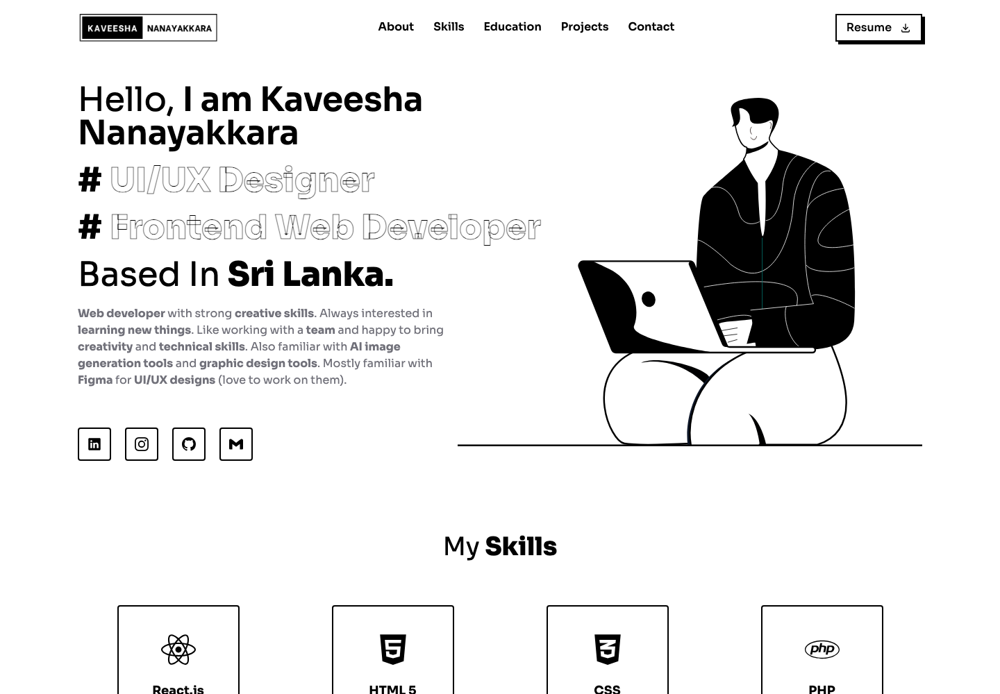
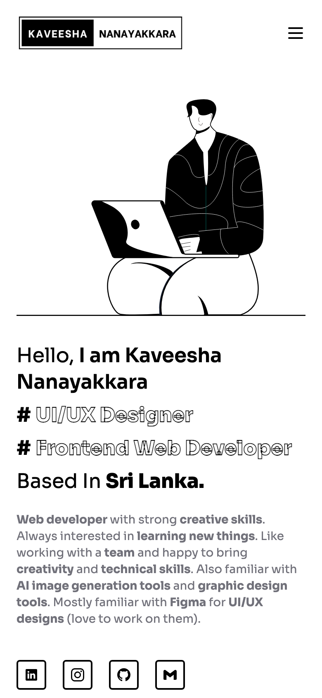
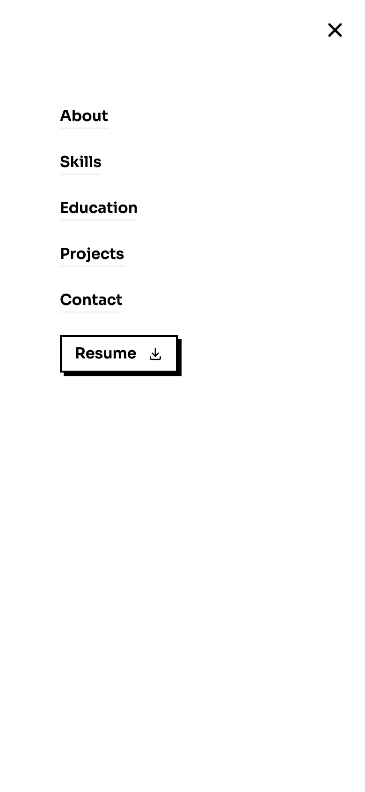
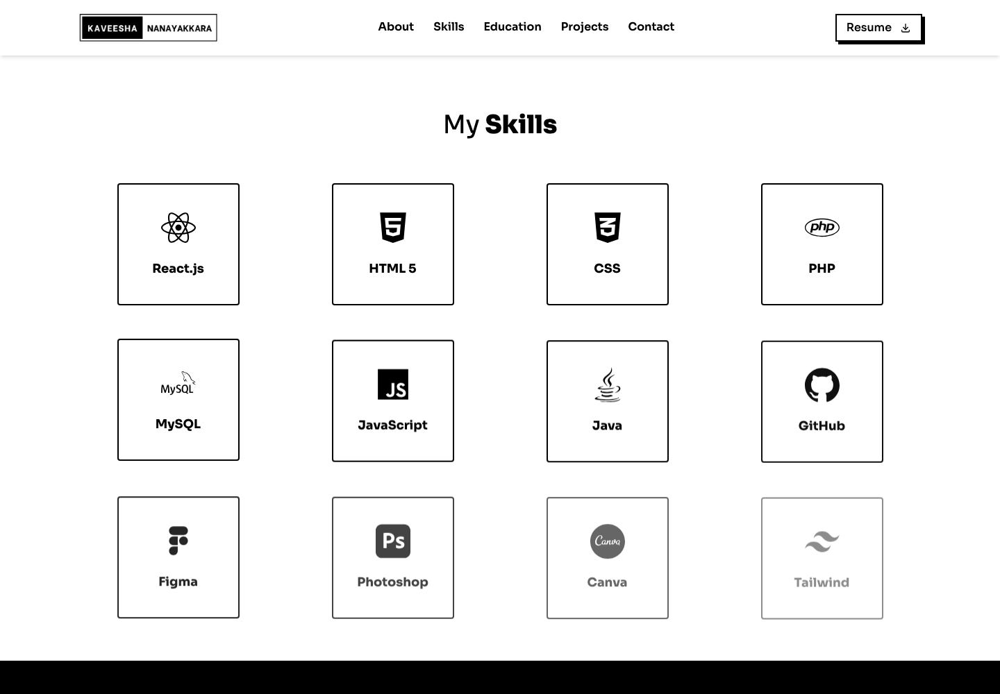
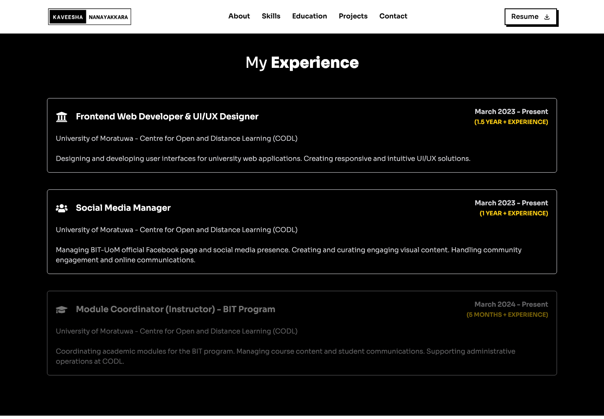
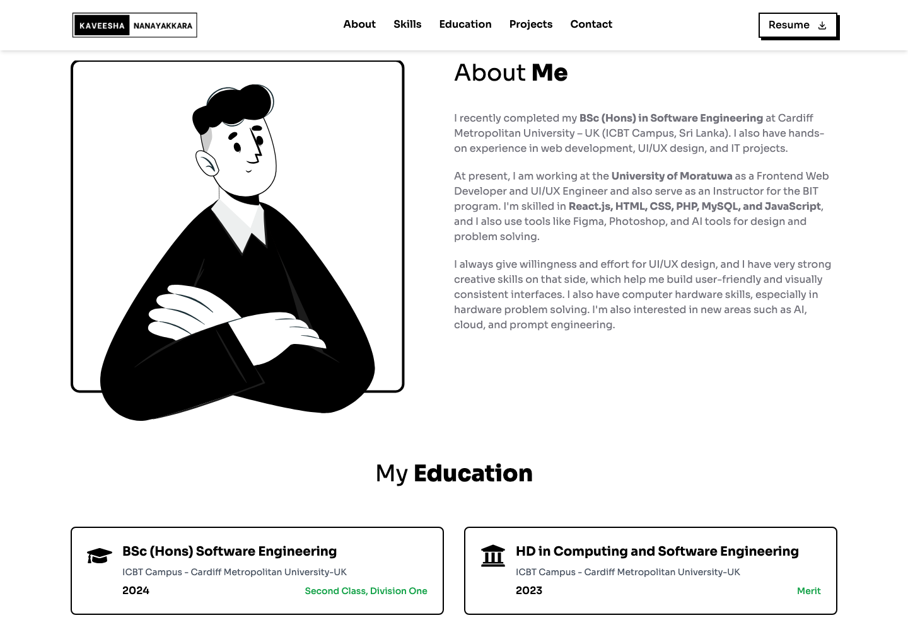
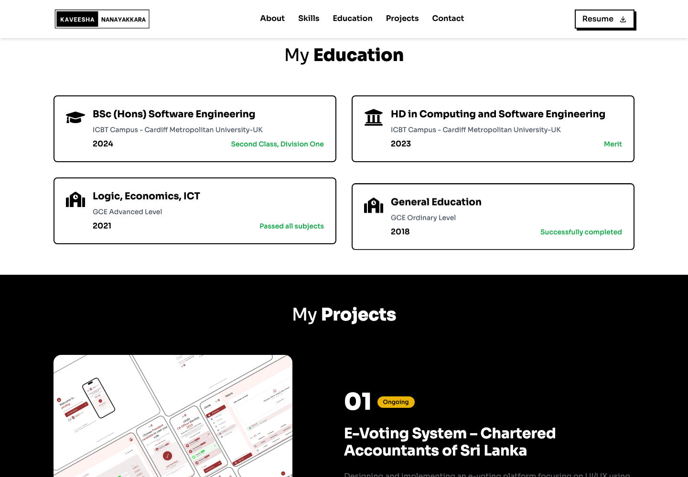
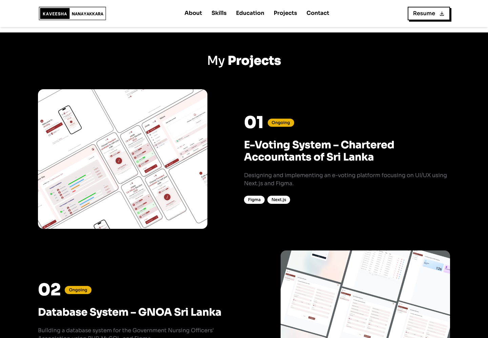
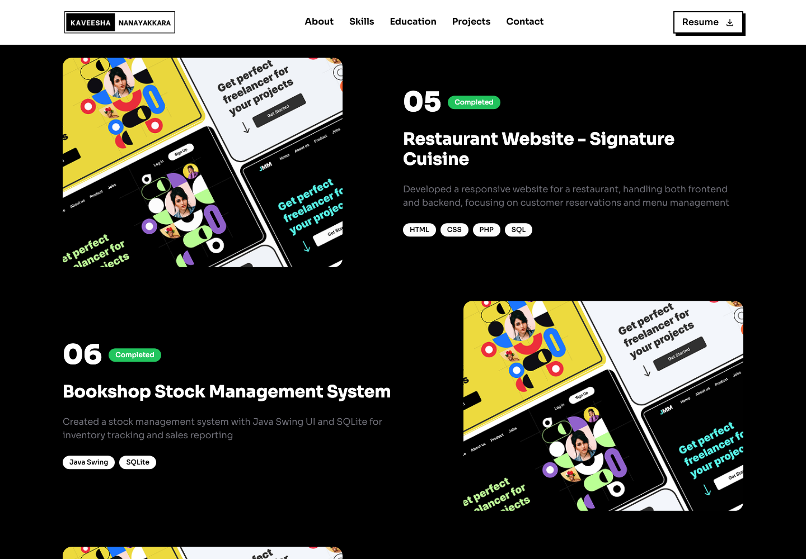
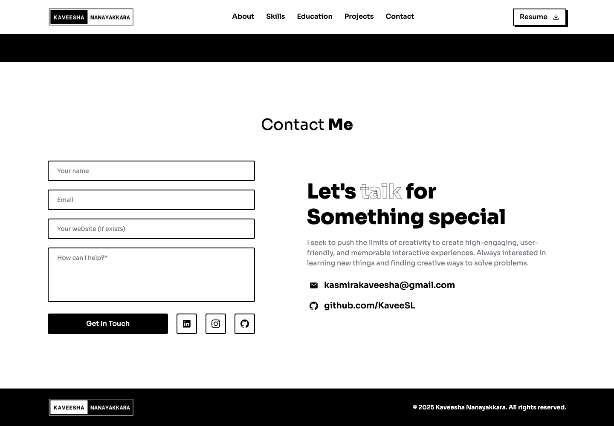

# Kaveesha Nanayakkara — Portfolio

Personal portfolio site for Kaveesha Nanayakkara, a frontend web developer and UI/UX designer based in Sri Lanka. It is a single scrolling page that introduces him, lists his skills and roles, summarizes his education, presents selected projects, and collects messages through a contact form.

The interface is a black-and-white layout with outlined display type, illustrated artwork, and small motion effects as each section comes into view.

## Contents

- [Project Overview](#project-overview)
- [Key Features](#key-features)
- [Technologies Used](#technologies-used)
- [Installation and Setup](#installation-and-setup)
- [Project Structure](#project-structure)
- [Additional Information](#additional-information)

## Project Overview

The site is a Vite + React application. `src/App.jsx` renders one page in this order: navigation, hero, skills and experience, about, education, projects, contact, and footer. There is no client-side router. Each section is a component with an element id, and the navigation scrolls to those ids.

All profile copy, skill names, jobs, qualifications, and projects are stored in the component files. Nothing is loaded from a CMS or a backend API. The contact form is the only network call in the interface: it sends the submitted fields through [EmailJS](https://www.emailjs.com/) from the browser.

Running `npm run build` writes a static site to `dist/`, which can be hosted on any static file host.

## Key Features

### Fixed navigation and resume link

The bar stays pinned to the top. On large screens it shows the logo, links for About, Skills, Education, Projects, and Contact, and a Resume button. Choosing a link smooth-scrolls to that section, offset by 110 pixels so the heading is not hidden under the bar. The logo scrolls back to the hero. After the page moves, the bar picks up a shadow.

Below the `lg` breakpoint the links collapse into a full-screen menu opened from a hamburger button. The same Resume action is available there. Resume opens a Google Drive file in a new tab. The URL is set in `handleResumeDownload` in `src/components/Navbar.jsx`. There is no resume file in this repository.



The hero sits under the navigation. A typing animation writes “I am Kaveesha Nanayakkara,” holds, then replaces it with a second phrase. The role lines “UI/UX Designer” and “Frontend Web Developer” use a white fill with a black stroke. A short biography and four actions sit underneath: LinkedIn, Instagram, and GitHub open in a new tab, and the mail button scrolls to the contact section. The illustration is `public/assets/hero-vector.svg`.

On viewports narrower than 640 pixels the hero stacks the illustration above the text, and the typed lines break so the name fits. The phrases for both widths are in `src/pages/Home.jsx`.





The mobile menu covers the viewport and closes after a section is chosen.

### Skills

Twelve cards list the tools shown on the site: React.js, HTML 5, CSS, PHP, MySQL, JavaScript, Java, GitHub, Figma, Photoshop, Canva, and Tailwind. Each card uses an icon from `react-icons`. Hovering a card inverts it to a black background with white text and icons. The cards fade in with a short staggered delay the first time the section enters the viewport.



The grid is two columns on small screens and four columns from the `md` breakpoint up.

### Experience

Directly under the skills grid, a black band lists three roles at the University of Moratuwa, Centre for Open and Distance Learning (CODL):

- Frontend Web Developer & UI/UX Designer, March 2023 – Present
- Social Media Manager, March 2023 – Present
- Module Coordinator (Instructor) for the BIT program, March 2024 – Present

Each card shows the role, the organization, a short description of the work, the date range, and a duration label. This block lives inside the skills section, so the Skills navigation item is what scrolls here. The data is the `experiences` array in `src/components/Skills.jsx`.



### About

The about section places `public/assets/about-me.svg` beside three paragraphs. The text covers a BSc (Hons) in Software Engineering from Cardiff Metropolitan University (ICBT Campus, Sri Lanka), current work at the University of Moratuwa, and the design and development tools used day to day. On small screens the illustration stacks above the text.



### Education

Four cards are laid out in one column, then two columns from the `md` breakpoint. Each card has an icon, qualification, institution, year, and result:

- BSc (Hons) Software Engineering, ICBT Campus – Cardiff Metropolitan University, UK, 2024, Second Class, Division One
- HD in Computing and Software Engineering, ICBT Campus – Cardiff Metropolitan University, UK, 2023, Merit
- Logic, Economics, ICT, GCE Advanced Level, 2021, Passed all subjects
- General Education, GCE Ordinary Level, 2018, Successfully completed



### Projects

The projects section is a black band of seven entries. From the `lg` breakpoint, image and text alternate sides. Each entry has a zero-padded number, a status pill, a title, a description, and technology tags. Ongoing work uses a yellow pill. Completed work uses a green pill. The list is the `projects` array in `src/components/Projects.jsx`.

| # | Project | Status | Tags |
| --- | --- | --- | --- |
| 01 | E-Voting System – Chartered Accountants of Sri Lanka | Ongoing | Figma, Next.js |
| 02 | Database System – GNOA Sri Lanka | Ongoing | Figma, PHP, MySQL |
| 03 | New LMS for CODL – University of Moratuwa | Ongoing | React.js, Figma, Material-UI, Tailwind |
| 04 | Personal Blog Website – nlgsl.com | Completed | PHP, HTML, CSS |
| 05 | Restaurant Website – Signature Cuisine | Completed | HTML, CSS, PHP, SQL |
| 06 | Bookshop Stock Management System | Completed | Java Swing, SQLite |
| 07 | Flower Bouquets Shop Mobile Application | Completed | Java Swing, SQLite |

Preview images are `public/assets/project1.png` through `project5.png`. Entries 06 and 07 currently both use `project5.png`.





### Contact form

The contact section is a form plus a short note. The fields are name, email, an optional website, and a message. Name, email, and message are required. Submitting calls `emailjs.sendForm` from `@emailjs/browser` with the service id, template id, and public key in `src/components/Contact.jsx`.

While the request is in flight the button label changes to “Sending...” and the button is disabled. A successful send clears the fields and shows a confirmation for three seconds. A failed send shows the error text for five seconds, together with the direct address `kasmirakaveesha@gmail.com`. LinkedIn, Instagram, and GitHub sit beside the button. The right-hand column repeats that email as a `mailto` link and links to [github.com/KaveeSL](https://github.com/KaveeSL).



The footer is the black bar at the bottom of that view. Its logo scrolls to the hero, and the text reads “© 2025 Kaveesha Nanayakkara. All rights reserved.”

### Motion and the custom cursor

[Framer Motion](https://www.framer.com/motion/) animates the navbar on load, the hero on load, and the later sections the first time they enter the viewport. Buttons and social icons scale slightly on hover.

`src/utils/CursorAnimation.jsx` draws a white circle that follows the mouse with `mix-blend-difference`. The circle grows when the pointer is over a heading or paragraph. It listens for `mousemove`, so it is a desktop pointer effect.

## Technologies Used

Versions below are the ranges declared in `package.json`.

| Area | Tools |
| --- | --- |
| Language | JavaScript (JSX) |
| UI | React 19, React DOM 19 |
| Build | Vite 6 |
| Styling | Tailwind CSS 3, PostCSS 8, Autoprefixer 10 |
| Motion | Framer Motion 12 |
| Icons | react-icons 5 |
| Typing headline | react-type-animation 3 |
| Contact delivery | @emailjs/browser 4 |
| Font | [Sora](https://fonts.google.com/specimen/Sora), loaded in `src/index.css` |
| Linting | ESLint 9, `eslint-plugin-react`, `eslint-plugin-react-hooks`, `eslint-plugin-react-refresh` |
| Toolchain | Node.js and npm |

`tailwind.config.js` registers the `font-sora` family and scans `index.html` and `src/**/*.{js,ts,jsx,tsx}`. The app itself is JavaScript, not TypeScript. `@types/react` and `@types/react-dom` are installed as dev dependencies for the editor.

Two packages are listed in `package.json` and are not imported by the application: `emailjs-com` and `sitemap`. The contact form uses `@emailjs/browser` only.

## Installation and Setup

Requirements: Node.js and npm.

```sh
git clone https://github.com/KaveeSL/nanayakkara.me.git
cd nanayakkara.me
npm install
npm run dev
```

Vite prints a local URL when the dev server starts. With the default settings that address is `http://localhost:5173/`.

Other scripts:

```sh
npm run build    # write the production site to dist/
npm run preview  # serve the built site locally
npm run lint     # run ESLint
```

There is no `.env` file. To send contact messages through your own EmailJS account, replace the service id, template id, and public key passed to `emailjs.sendForm` in `src/components/Contact.jsx`. The inputs use the names `name`, `email`, `website`, and `message`, which need to match the variables in the EmailJS template.

The Resume button is separate from EmailJS. Change the Drive URL in `src/components/Navbar.jsx` if the file moves.

## Project Structure

```text
nanayakkara.me/
├── index.html                 # document title, description, favicon
├── package.json
├── vite.config.js             # Vite with the React plugin
├── tailwind.config.js
├── postcss.config.js
├── eslint.config.js           # lints JS/JSX and ignores dist/
├── public/
│   ├── vite.svg
│   └── assets/                # files requested as /assets/...
│       ├── logo.png
│       ├── favicon.png
│       ├── hero-vector.svg
│       ├── about-me.svg
│       └── project1.png … project5.png
├── src/
│   ├── main.jsx               # mounts <App /> in #root
│   ├── App.jsx                # page order
│   ├── index.css              # Tailwind layers and the Sora font
│   ├── pages/Home.jsx         # hero, typing lines, social links
│   ├── components/
│   │   ├── Navbar.jsx
│   │   ├── Skills.jsx         # skills grid and experience
│   │   ├── About.jsx
│   │   ├── Education.jsx
│   │   ├── Projects.jsx
│   │   ├── Contact.jsx
│   │   └── Footer.jsx
│   └── utils/CursorAnimation.jsx
├── docs/screenshots/          # images used in this README
└── dist/                      # output of npm run build
```

Section ids used by the navigation and the hero mail button:

| id | Component |
| --- | --- |
| `home` | `src/pages/Home.jsx` |
| `skills` | `src/components/Skills.jsx` (includes experience) |
| `about` | `src/components/About.jsx` |
| `education` | `src/components/Education.jsx` |
| `projects` | `src/components/Projects.jsx` |
| `contact` | `src/components/Contact.jsx` |

## Additional Information

- Edit visible copy in the component that renders it. Skills and experience are in `Skills.jsx`, qualifications are in `Education.jsx`, and projects are in `Projects.jsx`.
- Images referenced by the page live in `public/assets` and are loaded from absolute paths such as `/assets/logo.png`. Replacing a file keeps the existing `src` path working if the filename stays the same.
- `public/assets/google.svg`, `public/assets/youtube.svg`, and `public/vite.svg` are not referenced by the React components. `src/assets/react.svg` is also unused. `src/App.css` is empty and is not imported.
- `index.html` sets the title to “KAVEESHA NANAYAKKARA”, a meta description, the favicon at `/assets/favicon.png`, and `theme-color` `#000000`. The Open Graph and Twitter blocks in that file are commented out, and they still point at an older Netlify URL and `/assets/preview.png`, which is not in `public/assets`.
- `dist/` is the production build checked into the repository. `dist/sitemap.xml` is empty, and no npm script generates a sitemap.
- Run `npm install` after cloning. That links the local CLIs, including Vite, before `npm run dev`.
- The screenshots in `docs/screenshots/` were captured from the local Vite server while this version of the site was running.
